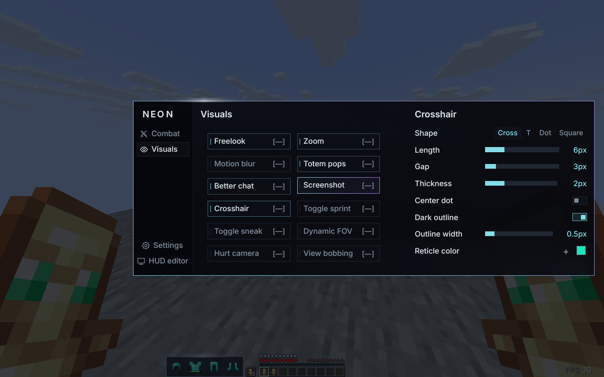
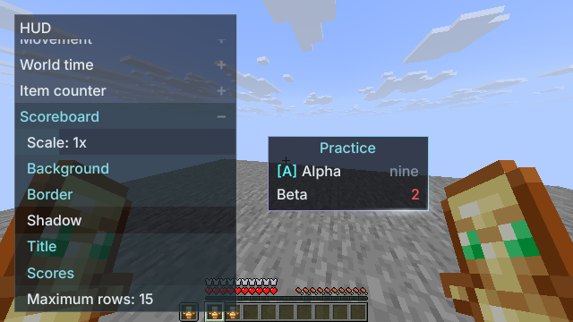

# Neon

A customizable **Minecraft 26.2 / Java 25** Fabric client with a consistent cyan/violet interface, **22 modules** and **23 HUD elements**. Neon focuses on everyday play, camera comfort, useful information and visual customization.



[Download](https://github.com/chronicaly/neon/releases/latest) · [User guide](docs/user-guide.md) · [Research](docs/client-research.md) · [Release notes](docs/release-0.5.0.md)

## Install

Use Minecraft **26.2**, **Java 25**, Fabric Loader **0.19.5+**, and Fabric API for 26.2. This release is built against **Fabric API 0.161.0+26.2**. Put the runnable `neon-0.5.0.jar` in your instance's `minecraft/mods` folder. Keep one Neon JAR; the sources JAR is for development. [Mod Menu](https://modrinth.com/mod/modmenu) is optional.

Open Neon with your saved menu key (**Insert** in the supplied Vanilla setup), **Right Shift**, or Mod Menu. A fresh configuration uses **P** as its primary key. Updates preserve saved keys, palette, alpha and custom HUD placements. New 0.5.0 modules and HUD widgets start disabled.

## Modules

The 15 additions share the same compact buttons, attached drawers, profiles, Undo and optional Toggle / Hold / Reverse hold bindings.

| New module | Controls and behavior |
| --- | --- |
| Crosshair | Cross, T, Dot or Square; fractional pixel length/gap/thickness, center dot, adjustable outline and theme-linked color. Unity-derived coverage centers it on odd/even framebuffers at every GUI scale. Keeps native eligibility and attack indication. |
| Toggle sprint | Native sprint toggle with optional resuming after menus; leaves Minecraft's saved preference intact. |
| Toggle sneak | Native crouch toggle with independent menu-resume control. |
| Dynamic FOV | Scales movement FOV effects without changing base FOV or Zoom. |
| Hurt camera | Reduces damage-camera movement; does not change damage. |
| View bobbing | Adjusts native camera bob strength; respects Minecraft's bobbing option. |
| Low fire | Lowers the first-person fire overlay while retaining the burn state. |
| Viewmodel | Horizontal, vertical and depth offsets, scale and optional offhand adjustment; keeps native use animations. |
| Enchant glint | Independent glint strength and speed. |
| Hit color | Theme-linked damage tint with adjustable strength and alpha. |
| Time changer | Cosmetic time of day; actual world time and gameplay rules remain unchanged. |
| Weather | Clear/rainy visuals and precipitation intensity, retaining native biome rules. Actual weather and ambient weather audio remain unchanged. |
| Fullbright | Adjustable lightmap enhancement. Suspends during darkness/blindness; grants no effect and leaves gamma unchanged. |
| Clean view | Independently hides pumpkin, portal and vignette overlays. |
| Block outline | Theme-linked color and display-pixel width; preserves native shape, depth and high-contrast backing. |

The existing seven remain: **Freelook**, **Zoom**, **Motion blur**, **Totem pops**, **Better chat**, **Better screenshot** and **Autoclicker**. Better chat preserves history, signatures and links, with independent message/mention ping volume. Better screenshot copies normal screenshots while preserving PNG saving. Motion blur starts disabled with 10% strength. See the [guide](docs/user-guide.md) for detailed behavior, including the existing autoclicker's persistent Toggle session.

## HUD

Open **HUD editor** directly beneath Settings. Each element has its own visibility and placement; new information widgets also have local Background, Border and Shadow controls.

| Group | Available elements |
| --- | --- |
| Equipment | Armor, Totems, Held item, Inventory, Item counter |
| Input and movement | Keystrokes, CPS, Speed, Movement |
| Navigation and world | Coordinates, Compass, Biome, Light level, World time |
| Status and session | Potion effects, Scoreboard, Server, Ping, Clock, Session |
| Client information | FPS, Memory, Resource packs |

Panels use the saved Neon palette, thin animated outlines and localized traveling highlights. General offers native-resolution **Inter** or pixel-snapped **Minecraft** text, and can disable outline animation or the new armor/floating-totem plates. Text sizing, origin snapping and shadow ordering adapt Unity's fixes. FPS retains independent Label, Value, Background and Border colors, each with **Sync** to restore its theme link. Minecraft mode follows the active resource-pack font; item models and decorations remain native.



Coordinates optionally show dimension and Nether conversion. CPS counts physical clicks, excluding menu and generated clicks; Keystrokes follows rebound movement keys. Item counter supports held item, pearls, arrows, rockets, both golden apples, experience bottles, obsidian and diamonds. Scoreboard optionally replaces the native sidebar, preserving team styles, hidden entries and number formatting; disable it to restore the native sidebar. World time reports actual synchronized time independently of Time changer.

Drag enabled widgets directly, resize at invisible corners, or use the wheel to scale. Arrow keys nudge one display pixel; Shift nudges ten. Right-click a row or widget for settings. Numeric values support exact entry. Disabled widgets remain in the column but do not render, receive canvas input or attract snapping. Armor defaults left of the offhand/hotbar; attached totems stay on the real offhand slot.

## Controls and appearance

- **Left-click a module:** toggle it. **Right-click:** open its settings drawer.
- **Click its bracketed bind:** assign a key or mouse button. **Right-click the bind:** cycle activation mode; hover shows the full mode name.
- **Settings:** Colors, Appearance and Profiles use the same button grid and drawers. Either mouse button opens a section.
- **Colors:** live HSV/opacity, original/current previews, hex, Copy/Paste and Sync. Escape/outside click keeps the applied color. Narrow windows temporarily give the attached color drawer the settings pane's space.
- **Numbers:** drag, Shift-drag for precision, or right-click for exact entry. **Ctrl+Z** reverses settings, bindings, profile loads and complete gestures.
- **Window:** drag the header; resize from invisible corners. Menu size is independent of Minecraft GUI scale. Smooth scrolling uses no scrollbars.
- **Escape:** cancels the active edit/gesture, then closes a color drawer, settings drawer or menu in order.

The default menu is 582×370 display pixels with native-resolution Inter text, light-glass buttons and one continuous cyan/violet outline. Press feedback keeps hitboxes fixed; animation reversals preserve motion; closing releases gameplay immediately. Copied/Saved acknowledgements appear after success. UI volume is independent of Minecraft audio; continuous adjustments stay silent.

## Build and verification

Requires JDK 25. The project uses unobfuscated Fabric Loom.

```powershell
./tools/build.ps1 -SkipInstall
```

On this development setup, `./tools/build.ps1` also runs the silent packaged release suite and installs only its exact checked runnable JAR into PrismLauncher's Vanilla instance. The prepared verification world is isolated from user instances. See [verification](docs/verification.md) and [0.5.0 results](docs/expansion-results.md).

Performance instrumentation and sound/clipboard interception live only in the verification mod, excluded from releases. Measurements report allocations and frame times with their limits; no FPS increase is promised.

## Sources and license

Neon is MIT licensed. [NOTICE](NOTICE) credits the author's Unity ports, Inter and dependencies. Official Lunar, Badlion, Feather and Laby documentation and public utility-client source informed the [research](docs/client-research.md). Unity's crosshair and HUD font fixes are adapted at the author's request. No proprietary client source, GPL implementation or third-party client assets are bundled.
