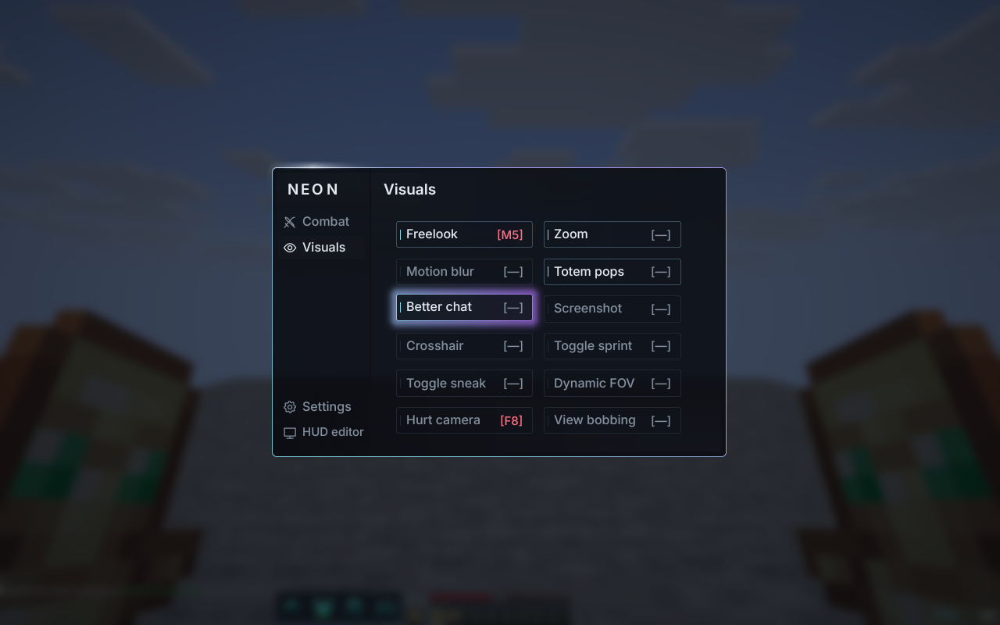
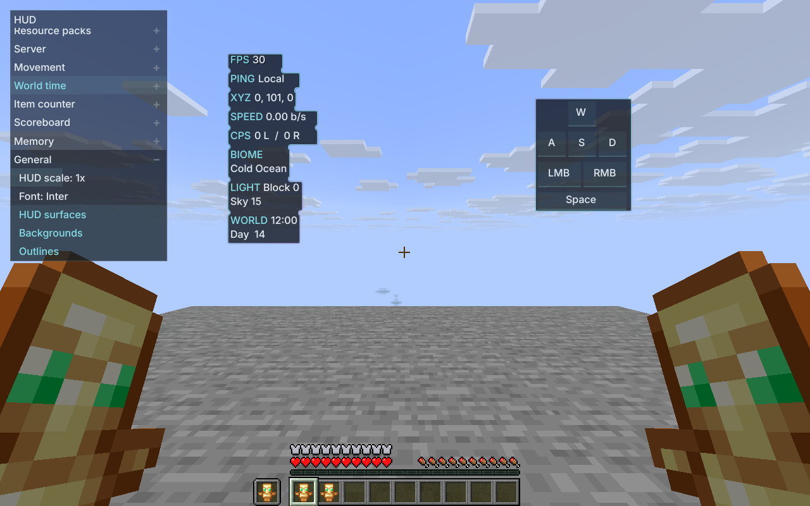
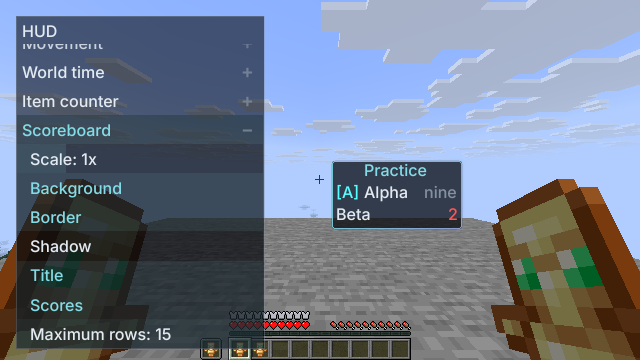
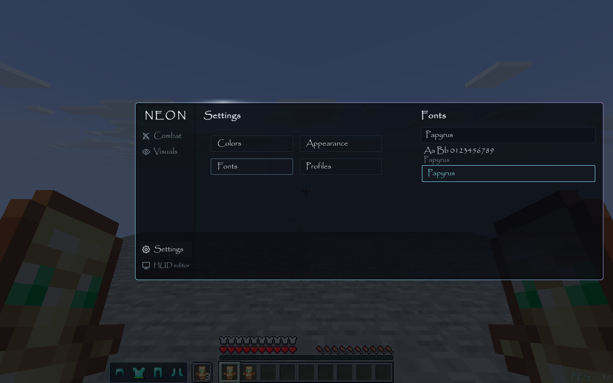
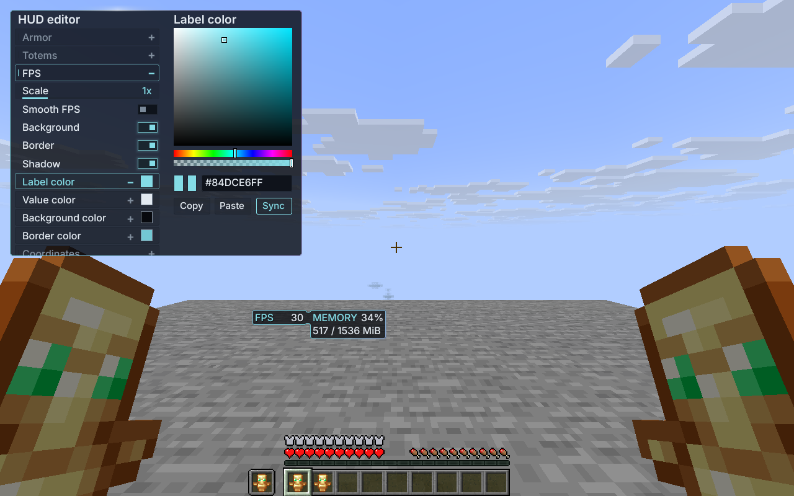

# Neon

A customizable **Minecraft 26.2 / Java 25** Fabric client with a consistent cyan/violet interface, **22 modules** and **24 HUD elements**. Neon focuses on everyday play, camera comfort, useful information and visual customization.



[Published downloads](https://github.com/chronicaly/neon/releases/latest) · [User guide](docs/user-guide.md) · [Research](docs/client-research.md) · [0.5.6 notes](docs/release-0.5.6.md)

**0.5.6 adds search on demand** to the module/Settings grids and HUD column. Search is hidden by default. Press **Ctrl+F** to reveal it, type a few words, then **Enter/Down** to focus a result without activating it. **Escape** clears the query, then hides search; clearing restores the previous scroll position. Filters never change enabled states or saved settings. Chat now reuses unchanged display groups and packed glyph batches, reducing measured allocation costs while preserving original history, signatures, links and sound rules. See the [verification and measurement report](docs/improvements-results.md) and [0.5.6 downloads](https://github.com/chronicaly/neon/releases/tag/v0.5.6).

**0.5.5 keeps bottom-left Chat and Coordinates together**, with a six-pixel gap and shared smooth movement above the chat input. **HUD editor → Chat → Message bar** hides the server-message stripe and removes its reserved left space, including when Better chat is disabled. **Potion effects → Hide vanilla icons** removes duplicate top-right status icons while that HUD is enabled; **Visuals → Clean view → Hide effect icons** works independently. Both icon options start off and preserve active effects.

Widget edges catch at six-pixel spacing and align before overlapping; push farther to overlap deliberately, or hold Alt to bypass snapping. Clicking a canvas widget smoothly opens its settings. The HUD editor and its attached color drawer share one animated neon outline. Armor stays fixed beneath chat, and Coordinates no longer adds dimension text.

The **HUD editor and Settings** now share Neon's translucent dark panels, native headings, light-glass controls and rounded fields. Panel surfaces use 84% of the saved background alpha/opacity; text and controls remain clear. HUD options use the familiar cyan switches and aligned values while keeping the compact draggable column and direct canvas placement.

**Settings → Fonts** lists the fonts installed on your PC, including Papyrus when available, with search and a live preview. Selection applies to Neon menus, Client-mode HUD text and Better chat's Client font, persists in profiles, and supports Undo. Bottom information widgets move smoothly above the chat input and return on close; joined widgets keep their spacing and saved positions stay unchanged. Armor and attached totems stay in place.

## Install

Use Minecraft **26.2**, **Java 25**, Fabric Loader **0.19.5+**, and Fabric API for 26.2. This build uses **Fabric API 0.161.0+26.2**. Put the runnable `neon-0.5.6.jar` in your instance's `minecraft/mods` folder. Keep one Neon JAR; the sources JAR is for development. [Mod Menu](https://modrinth.com/mod/modmenu) is optional.

Open Neon with your saved menu key (**Insert** in the supplied Vanilla setup), **Right Shift**, or Mod Menu. A fresh configuration uses **P** as its primary key. Updates preserve saved keys, palette, alpha and custom HUD placements. New 0.5.0 modules and HUD widgets start disabled.

## Modules

The 15 additions share the same compact buttons, attached drawers, profiles, Undo and optional Toggle / Hold / Reverse hold bindings.

| New module | Controls and behavior |
| --- | --- |
| Crosshair | Cross, T, Dot or Square; fractional pixel length/gap/thickness, center dot, adjustable outline and theme-linked color. Unity-derived coverage centers it on odd/even framebuffers at every GUI scale. Keeps native eligibility and attack indication. |
| Toggle sprint | Native sprint toggle with optional resuming after menus; leaves Minecraft's saved preference intact. |
| Toggle sneak | Native crouch toggle with independent menu-resume control. |
| Dynamic FOV | Scales movement FOV effects without changing base FOV or Zoom. |
| Hurt camera | Reduces damage-camera movement; does not change damage. |
| View bobbing | Adjusts native camera bob strength; respects Minecraft's bobbing option. |
| Low fire | Lowers the first-person fire overlay while retaining the burn state. |
| Viewmodel | Horizontal, vertical and depth offsets, scale and optional offhand adjustment; keeps native use animations. |
| Enchant glint | Independent glint strength and speed. |
| Hit color | Theme-linked damage tint with adjustable strength and alpha. |
| Time changer | Cosmetic time of day; actual world time and gameplay rules remain unchanged. |
| Weather | Clear/rainy visuals and precipitation intensity, retaining native biome rules. Actual weather and ambient weather audio remain unchanged. |
| Fullbright | Adjustable lightmap enhancement. Suspends during darkness/blindness; grants no effect and leaves gamma unchanged. |
| Clean view | Independently hides pumpkin, portal and vignette overlays and top-right effect icons. |
| Block outline | Unity-derived Outline, Both, Fill and Glow styles, plus native Wire. Width, fill opacity, Neon gradient, bloom, and theme-linked color/Sync. Preserves native targeting, voxel shapes and depth; Wire retains high-contrast backing. |

The existing seven remain: **Freelook**, **Zoom**, **Motion blur**, **Totem pops**, **Better chat**, **Better screenshot** and **Autoclicker**. Better chat preserves history, signatures and links, with independent message/mention ping volume. Better screenshot copies normal screenshots while preserving PNG saving. Motion blur starts disabled with 10% strength. See the [guide](docs/user-guide.md) for detailed behavior, including the existing autoclicker's persistent Toggle session.

## HUD

Open **HUD editor** directly beneath Settings. Each element has its own visibility and placement; new information widgets also have local Background, Border and Shadow controls.

| Group | Available elements |
| --- | --- |
| Equipment | Armor, Totems, Held item, Inventory, Item counter |
| Input and movement | Keystrokes, CPS, Speed, Movement |
| Navigation and world | Coordinates, Compass, Biome, Light level, World time |
| Status and session | Potion effects, Scoreboard, Server, Ping, Clock, Session |
| Client information | FPS, Memory, Resource packs |
| Communication | Chat (native history, with optional Neon placement and frame) |

Panels fit their content with tight padding and gently rounded corners. Bringing enabled panels within the editor's six-pixel spacing joins their glass backgrounds and outside contours; moving them apart separates them. Overlaps do not double the background opacity, and joined surfaces have no internal border. All outlines share one cyan/violet animation and the saved palette/alpha.

General offers **HUD surfaces** (master for both backgrounds and outlines), independent **Backgrounds** and **Outlines**, **Animated outline**, and **Equipment panels**. These switches preserve each widget's local preferences. **Client** text uses the native-resolution font selected in Settings, defaulting to bundled Inter; **Minecraft** retains pixel-snapped resource-pack text. Font sizing, origin snapping and shadow ordering adapt Unity's fixes. FPS uses the same padding, label/value styling and outline renderer, retaining four independent colors and per-color **Sync**. Item models and decorations remain native.





Coordinates uses Unity's compact comma-separated format with optional inline Nether conversion; dimension text is removed. CPS counts physical clicks, excluding menu and generated clicks; Keystrokes follows rebound movement keys. Item counter supports held item, pearls, arrows, rockets, both golden apples, experience bottles, obsidian and diamonds. Scoreboard optionally replaces the native sidebar, preserving team styles, hidden entries and number formatting; disable it to restore the native sidebar. World time reports actual synchronized time independently of Time changer.

Drag enabled widgets directly, resize at invisible corners, or use the wheel to scale. Adjacent edges catch before overlap even with General → Snap off; that setting controls additional alignment. Continue dragging beyond the catch to overlap deliberately. Alt bypasses snapping. Arrow keys nudge one display pixel; Shift nudges ten. Click a canvas widget, or right-click a row/widget, to reveal its settings. A drag never opens a fold. Numeric values support exact entry. Disabled widgets remain in the column but do not render, receive canvas input or attract snapping. Armor defaults left of the offhand/hotbar; attached totems stay on the real offhand slot.

**Better chat** now adapts Unity's font layout, native click areas, chat frame and input styling. Client font and Input frame are on by default under Visuals → Better chat. Disable Client font to restore Minecraft's chat font. Enable **Chat** in the HUD editor to move/resize native chat and give it a Neon background, outline and shadow; the optional Chat HUD starts disabled. Duplicate counts, entry animation, name highlighting, original history, signatures and clickable links remain intact. Reflows and local notices never trigger message pings.

**Chat → Message bar** shares its preference with Better chat's setting and also works with the custom Chat HUD disabled. Hiding it closes the native four-unit gutter and keeps links aligned; the custom panel retains two units of ordinary text padding. When Chat and Coordinates are both enabled near the bottom-left, chat stays above Coordinates without overlap. They rise and return together over 220 ms, including interrupted openings. Small displays shorten the visible chat area while retaining native scrolling. Moving either widget away releases this special arrangement; saved placements are never rewritten. Armor stays fixed.

## Controls and appearance

- **Left-click a module:** toggle it. **Right-click:** open its settings drawer.
- **Click its bracketed bind:** assign a key or mouse button. **Right-click the bind:** cycle activation mode; hover shows the full mode name.
- **Settings:** Colors, Appearance, Fonts and Profiles use the same button grid and drawers. Either mouse button opens a section. All four sidebar actions share aligned icon/text columns; selection uses a faint tint without a boxed outline.
- **Fonts:** search installed families, select one for a live preview, or choose Inter. An unavailable saved font falls back to Inter while retaining its name for another PC.
- **Colors:** live HSV/opacity, original/current previews, hex, Copy/Paste and Sync. Escape/outside click keeps the applied color. Narrow windows temporarily give the attached color drawer the settings pane's space.
- **Numbers:** drag, Shift-drag for precision, or right-click for exact entry. **Ctrl+Z** reverses settings, bindings, profile loads and complete gestures.
- **Window:** drag the header; resize from invisible corners. Menu size is independent of Minecraft GUI scale. Smooth scrolling uses no scrollbars.
- **Escape:** cancels the active edit/gesture, then closes a color drawer, settings drawer or menu in order.

The default menu is 582×370 display pixels with native-resolution Inter text, light-glass buttons and one continuous cyan/violet outline. Its six-pixel outer corners and three-pixel button corners stay at native display resolution across GUI scales. Attached drawers share the same rounded shell. Press feedback keeps hitboxes fixed; animation reversals preserve motion; closing releases gameplay immediately. Copied/Saved acknowledgements appear after success. UI volume is independent of Minecraft audio; continuous adjustments stay silent.





## Build and verification

Requires JDK 25. The project uses unobfuscated Fabric Loom.

```powershell
./tools/build.ps1 -SkipInstall
```

On this development setup, `./tools/build.ps1` also runs the silent packaged release suite and installs only its exact checked runnable JAR into PrismLauncher's Vanilla instance. The prepared verification world is isolated from user instances. See [verification](docs/verification.md) and [0.5.6 results](docs/improvements-results.md).

Performance instrumentation and sound/clipboard interception live only in the verification mod, excluded from releases. Measurements report allocations and frame times with their limits; no FPS increase is promised.

## Sources and license

Neon is MIT licensed. [NOTICE](NOTICE) credits the author's Unity ports, Inter and dependencies. Official Lunar, Badlion, Feather and Laby documentation and public utility-client source informed the [research](docs/client-research.md). Unity's crosshair and HUD font fixes are adapted at the author's request. No proprietary client source, GPL implementation or third-party client assets are bundled.
