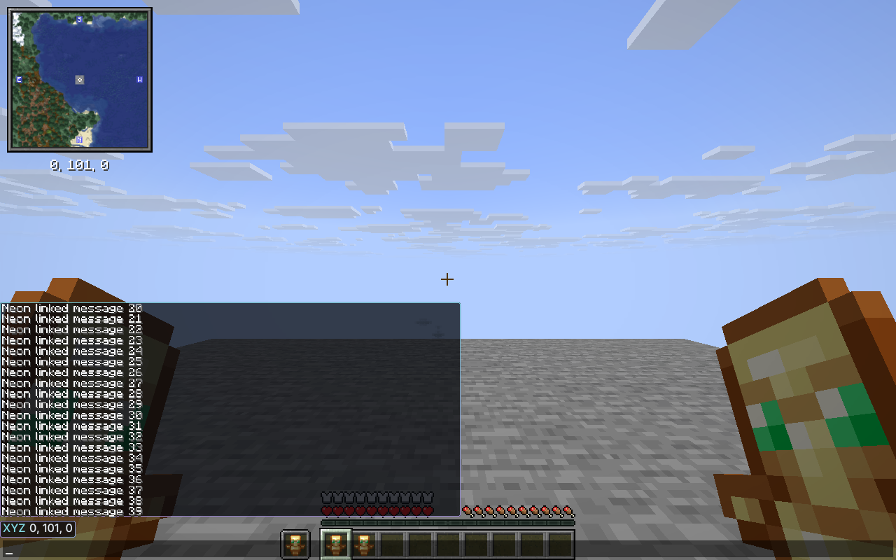

# Chat stacking and effect icon controls — 17 November 2026

Neon 0.5.5 adds shared Chat/Coordinates placement at the bottom-left, a gap-free Chat message-bar preference, and independent native effect-icon switches in Potion effects and Clean view.

## Verification and delivery

The Gradle compilation/unit build passed **153 tests**. The full packaged release suite passed **21,973 live checks** against runnable JAR SHA-256 `8883fb98b42edb9e8bce96099df72145acf32638508250abb8cf55aee7cd167e`, using verification harness `3b54192803da638911f41d5e23a2243b5bc438eb918bb562f9213ae943a913b0`. The release includes that exact-JAR receipt and checksums. Profiling, clipboard interception and audio interception remain in the separate verification mod.

Installation completed after the original Windows lock was released: the guarded one-shot installer recorded `installed` at **2026-11-17T13:32:25.3700542Z**. Vanilla's `neon.jar` was rechecked at the start of the 0.5.6 work and matched the exact 0.5.5 hash above. The earlier pending-install note is therefore resolved. The running game was never closed for installation, and Unity's checkout/artifacts were preserved. Status evidence remains in Vanilla's `minecraft/neon-pending/0.5.5/status.json`; later delivery is tracked in the [0.5.6 report](improvements-results.md).

## Behavior checked

- Both native foreground/background chat renderers respect Message bar across all combinations of Better chat and Chat HUD visibility. Native warning icons, signatures, original history and redraw silence remain intact. Unity's `MixinChatSigningBar.java` was inspected as a behavior reference; Neon's implementation retains native trust metadata and suppresses only the stripe.
- Native drawing and link collection share the adjusted pose. Hiding the stripe removes its four-unit gutter; custom panels retain two units of ordinary padding. Live linked text remains clickable at the rendered position across GUI/chat scale variants.
- Bottom-left Chat and Coordinates keep six physical pixels of separation and exactly the same per-frame displacement through opening, closing and rapid reopening. The stack clears the real input widget, stays inside the display and never changes serialized placements. Moving Coordinates away or disabling it releases the arrangement. Existing armor-fixed and other-widget overlap checks also pass.
- All 16 combinations of Potion HUD visibility, its Hide vanilla icons switch, Clean view activation and its Hide effect icons switch were exercised against the actual native icon renderer. Every combination preserves the real active effect and amplifier.
- Real pointer interaction, profile-file reload and Undo pass for the new HUD rows at default and minimum viewports. Existing release checks cover all module/settings pages, keyboard reveal, compact controls, sounds, font selection, color drawers, animated outlines and HUD gestures. Verification audio is fully muted.

The actual [Potion effects fold](images/neon-potion-icons-default.png), [minimum HUD column](images/neon-potion-icons-minimum.png), [Chat switch](images/neon-chat-line-minimum.png), [Clean view drawer](images/neon-clean-icons-default.png) and [minimum Clean view drawer](images/neon-clean-icons-minimum.png) were inspected. Controls remain readable and inside their panes.

The [640×360 capture](images/neon-chat-stack-minimum.png) shows the same separation on a small display.

## Measured costs

The same verification harness compared frozen public 0.5.4 (`9e6bfd63808390af579ffce16daa7d2ab8b38356330c0b1b2235af2d974b4f90`) with the exact 0.5.5 delivery JAR. Each scenario used three runs, 240 warm-up frames and 480 sampled frames per run. Gameplay is the default-HUD control; chat-docked enables bottom-left Chat and Coordinates, hides the stripe and displays native linked chat with the input open.

Values are medians of the three per-run results:

| Build / scenario | Frame median ms | p95 ms | p99 ms | Instrumented scope µs/frame | Instrumented bytes/frame |
| --- | ---: | ---: | ---: | ---: | ---: |
| 0.5.4 gameplay | 8.335 | 10.317 | 11.101 | 142.317 | 12685.967 |
| 0.5.5 gameplay | 8.337 | 10.266 | 11.335 | 139.818 | 12687.050 |
| 0.5.4 chat/coordinates | 8.332 | 10.015 | 11.717 | 403.099 | 120004.350 |
| 0.5.5 chat stack | 8.338 | 10.399 | 11.572 | 422.104 | 121204.633 |

The new arrangement adds about **1% instrumented allocations** and **4.7% scoped time** in this fixture. No frame percentile regressed more than 5% in two paired runs. The 120 FPS limiter dominates medians; one delivery run had a higher p99. These measurements cover instrumented extraction and deferred Neon rendering, not all Minecraft/native/GPU work, and do not establish an FPS improvement. User Minecraft instances remained open. All 2,880 baseline samples were focused; 960 of 2,880 delivery samples were unfocused, and neither run was iconified. The harness suppresses AFK throttling, but focus/scheduling differences still limit timing comparisons; raw flags are included.

See [all per-run results](chat-dock-measurements.md), [machine-readable statistics](chat-dock-measurements.json) and [raw CSVs plus JAR identities](chat-dock-samples.zip).
