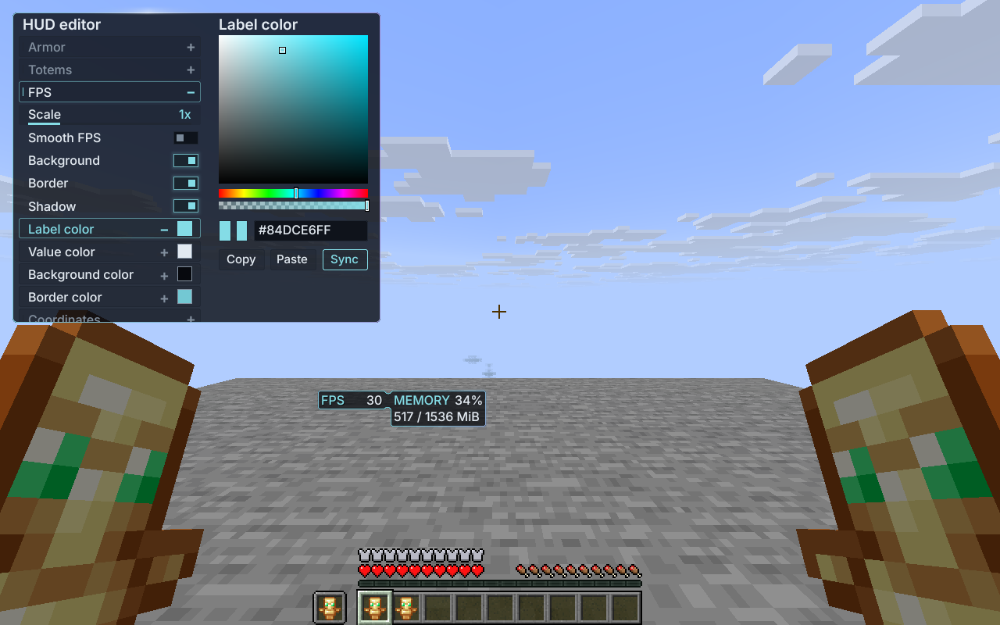
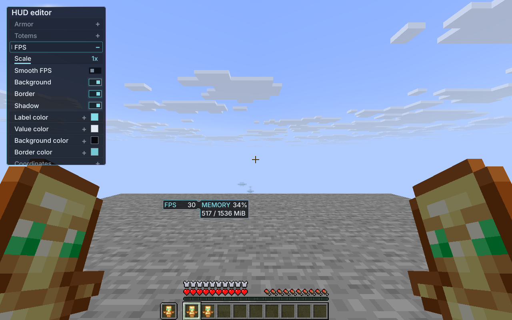
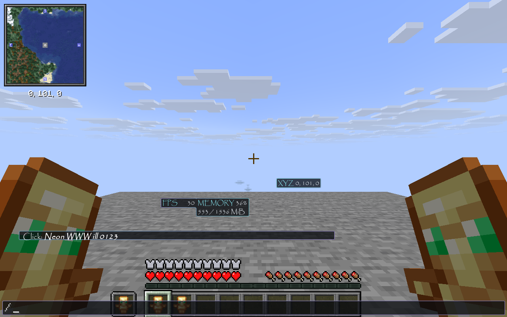
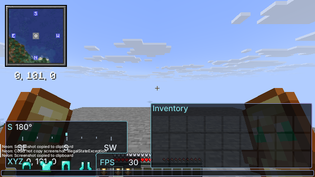

# Unity chat and HUD polish verification — 16 November 2026

Neon 0.5.3 restores the HUD editor's animated outline, adds canvas-click settings and deliberate-overlap snapping, keeps armor fixed beneath chat, removes coordinate dimension text, and adapts Unity's chat rendering/placement to Neon's installed fonts.

## Functional checks

The final installing build passed **148 JUnit tests and 20,646 packaged live checks**. The runnable JAR, release-test copy and PrismLauncher Vanilla installation share SHA-256 `2577a6de0d60493ae6a11f10171922aabbfdd3da7f28bf7ea70abe90a491d03d`. Verification harness SHA-256: `9bfdb5a769b392291538f9eed1296833a35b8c502da6f158853a419a6abfe9f1`. The exact-JAR receipt ships with the release.

- Actual Gradle builds pass **148 JUnit tests**, including five new edge-magnet tests covering all four approaches, fast crossings, resistance, deliberate overlap, existing overlap, hidden neighbors and perpendicular cluster alignment.
- The focused packaged-client suite passes **38 live checks**, repeated inside the full gate. Real pointer events verify catch/force/Alt behavior and gesture Undo; click jitter does not move a widget; dragging does not open settings; folds grow smoothly. The column and attached color drawer each submit one continuous animated outline, and the highlight advances over time.
- **92 chat-clearance checks** cover normal/minimum windows and GUI scales 1–3, including opening, closing, rapid reversal, joined panels, unchanged saved positions and armor staying fixed beneath chat.
- Native chat layout and clickable-style collection use the same proportional advances and moved/scaled transform. Focused coverage includes GUI scales 1–3, fractional native chat scale, Papyrus when installed, mixed bold/italic/link styles, the last glyph's click region, switching back to the Minecraft font, and messages arriving while the editor remains open.
- The existing silent Better chat/page suite passed **17,000 checks** during development, preserving duplicates, mentions, signatures, original history, accepted-message-only pings and default/minimum module/settings layouts. The final release gate repeated those checks against the delivered JAR.

All test clients run in an isolated prepared world. Minecraft and Neon sound are intercepted without playback; clipboard writes remain intercepted. User game instances and Unity's separate checkout/artifacts are preserved. Profiling and interception are excluded from the distributed JAR.

## Actual client captures









Screenshots show a single animation frame; the live checks verify movement over time. Module and Settings pages were also inspected at [default size](images/neon-chat-settings-default.png), [minimum size with scrolled chat controls](images/neon-chat-settings-minimum.png) and [minimum Settings size](images/neon-chat-settings-colors.png).

## Reproduce

```powershell
./tools/build.ps1 -SkipInstall
./gradlew.bat prodSmoke -PhudPolishOnly --console=plain
./gradlew.bat prodSmoke -PchatLiftOnly --console=plain
./tools/build.ps1
```

The installing build requires the full packaged suite and matching production/harness hashes. It replaces the installed file by rename; a running game's locked JAR is never truncated. The new code loads on the next Minecraft launch.

## Measured frame times and allocations

The final pair compares the frozen published 0.5.2 JAR (`77c904ba95376ea31cb4d80c1e478a583e406244568515286ec4c25828f36dab`) with the exact installed/released 0.5.3 JAR listed above. Both use the same final verification harness. Each scenario has three runs per version, with 240 warm-up frames followed by 480 sampled frames. The table gives medians of the three per-run results.

| Build/scenario | Frame median ms | p95 ms | p99 ms | Instrumented scope µs/frame | Instrumented bytes/frame |
| --- | ---: | ---: | ---: | ---: | ---: |
| 0.5.2 gameplay | 8.336 | 9.742 | 10.889 | 88.438 | 12674.967 |
| 0.5.3 gameplay | 8.331 | 9.785 | 10.969 | 88.466 | 12892.917 |
| 0.5.2 hud-placement | 8.334 | 9.819 | 10.609 | 636.126 | 56728.150 |
| 0.5.3 hud-placement | 8.334 | 9.764 | 10.532 | 687.788 | 64727.900 |
| 0.5.2 chat-visible | 8.334 | 9.768 | 10.849 | 171.257 | 85404.583 |
| 0.5.3 chat-visible | 8.332 | 9.709 | 10.339 | 471.755 | 227034.950 |

The visible-chat case opens native chat with 24 styled messages and links; both versions use their default fonts, so wrapping differs. HUD placement repeatedly drags equipment in the editor. The new chat path batches glyphs, caches bounded layouts and combines matching hit/decoration spans while retaining per-glyph advances and pixel origins. Its additional allocation and scoped cost are reported above. The 120 FPS limiter dominates medians; these measurements do not establish an FPS increase.

Native window focus: 0.5.2 has 0 unfocused frames out of 4320; 0.5.3 has 0 out of 4320. Iconified frames: 0 and 0. Earlier development captures had mixed focus and are not used for this final table. The harness prevents Minecraft AFK throttling, but native focus, shared CPU/GPU contention from kept-open user games and operating-system scheduling still limit causal conclusions about tail changes.

Environment: Windows 11 Pro, Ryzen 9 5950X, RTX 2060 (driver 32.0.16.1742), Java 25.0.5, 1280×800, GUI scale 2, VSync off, render/simulation distances 6/5 and 1536 MiB heap. The same isolated world and compatibility mods are used throughout. Windows thread CPU-clock resolution is coarse. Profiling remains entirely in the verification mod. Zero scoped upload/pass counters do not mean zero native or GPU work.

Evidence: [per-run comparison](chat-hud-measurements.md), [JSON](chat-hud-measurements.json), and [raw samples/environment](chat-hud-samples.zip).
