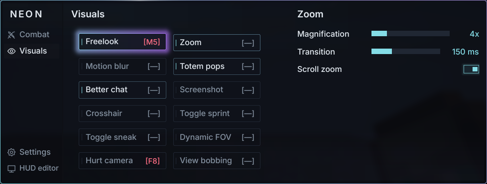
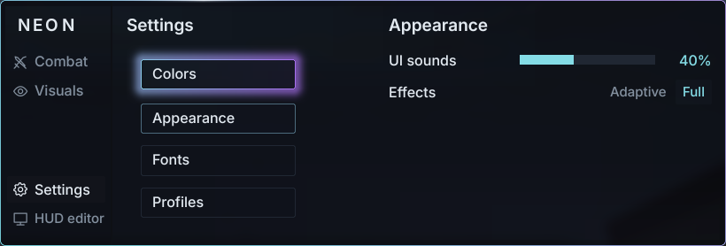

# HUD contact, glow corners and chat bar — 16 November 2026

Neon 0.5.4 removes the stroked-curve operations used to merge touching HUD panels, caches geometry relative to its origin, fixes dark corner gaps in button bloom, and adds Better chat's Message bar toggle.

## Final verification and installation

The final Gradle build passed **150 JUnit tests and 21,326 packaged live checks**. Its exact runnable JAR was installed into PrismLauncher Vanilla without closing user Minecraft instances. The build, tested copy and installed `mods/neon.jar` share SHA-256 `9e6bfd63808390af579ffce16daa7d2ab8b38356330c0b1b2235af2d974b4f90`. Verification harness SHA-256: `929df737cdbcbe0472e45b853c9c88363043b27987e0dfad3e747e2e7a5a22d1`.

The complete gate includes the new chat-bar, translated-cluster and glow-corner checks, plus existing interactions, colors, FPS overrides, screenshots, page layouts, modules, alignment, chat movement, fonts and HUD editing. The runnable JAR contains no verification/profiling classes. Unity's separate checkout and artifacts remain untouched. Restart Minecraft to load the installed update. The release includes the exact-JAR receipt and checksums.

## Changes and focused checks

Rounded HUD paths are flattened before union. Facing edges join across at most six display pixels; overlaps remain one translucent fill with one outside contour. The geometry keeps holes and per-widget FPS colors. A bounded 96-entry cache reuses translated clusters, and matching fill/outline sets share their mesh lookup. Isolated panel/menu corner geometry stays unchanged.

The [actual joined-HUD framebuffer](images/neon-contact-joined.png) retains the continuous outer contour and removes the internal border. Separate checks cover separating the widgets, hidden neighbors, independent visibility gates and local FPS colors.

The Gradle build passes **150 unit tests**, including contact/overlap offsets, bounded mesh complexity, finite fill geometry, six-pixel separation, holes and configuration round trips. The packaged release suite also checks translated-cluster mesh reuse and actual joined/separated HUD framebuffer pixels.

Button bloom previously omitted a square center while the button surface had rounded corners. Its new nine-slice Gaussian includes the rounded corner cutouts and uses exactly the surface's snapped physical bounds. **78 focused GPU/layout checks** pass across module/Settings buttons, default/minimum windows and GUI scales 1–3, including all four corner pixels, visible cyan/violet bloom and complete fade-out. Running the new corner assertion against the frozen 0.5.3 JAR reproduces the defect: the top-left corner has zero glow gain and fails. The fixed build passes that assertion. Hitboxes, two-pixel hover lift, press feedback and the transparent button interior are retained.

Message bar defaults on to preserve existing configurations. Disabling it suppresses only the native indicator fill in focused and background chat. The release suite checks those two render paths, disabled-module fallback, retained warning icons/history/signatures, silence on redraw, real settings interaction, profiles and Undo.

The actual Better chat drawer was inspected at [default size](images/neon-chat-bar-default.png) and [minimum size](images/neon-chat-bar-minimum.png). Message bar remains visible near the top; the remaining controls retain smooth scrolling.





## Measured frame times and allocations

The comparison uses frozen published 0.5.3 (`2577a6de0d60493ae6a11f10171922aabbfdd3da7f28bf7ea70abe90a491d03d`) and the 0.5.4 delivery JAR (`9e6bfd63808390af579ffce16daa7d2ab8b38356330c0b1b2235af2d974b4f90`), with the same benchmark implementation and instrumentation. Each scenario has three runs per version, 240 warm-up frames and 480 sampled frames per run. Values below are medians of the three per-run results.

The contact case moves the real FPS panel through separation, six-pixel joining and overlap with Inventory every frame, including small perpendicular offsets. The joined case leaves those panels stationary at six-pixel spacing. Gameplay is the default-HUD control.

| Build / scenario | Frame median ms | p95 ms | p99 ms | Instrumented scope µs/frame | Instrumented bytes/frame |
| --- | ---: | ---: | ---: | ---: | ---: |
| 0.5.3 gameplay | 8.339 | 10.442 | 11.518 | 161.002 | 12984.300 |
| 0.5.4 gameplay | 8.336 | 10.093 | 11.486 | 122.862 | 12685.517 |
| 0.5.3 HUD contact | 8.336 | 9.888 | 11.853 | 407.320 | 107088.883 |
| 0.5.4 HUD contact | 8.337 | 9.964 | 11.134 | 162.508 | 39124.217 |
| 0.5.3 joined HUD | 8.335 | 9.967 | 10.903 | 115.244 | 11140.533 |
| 0.5.4 joined HUD | 8.338 | 9.982 | 10.588 | 89.307 | 10962.667 |

The moving-contact case reduces scoped wall time by approximately **60%** and allocations by **63%**. These scopes include Neon extraction and deferred surface/glyph vertex work, not all Minecraft/native/GPU work. The 120 FPS limiter dominates frame medians. This is a deterministic reproduction of the contact path, not a recording of the user's original severe stall, and does not establish a general FPS increase.

Native focus was mixed: 2647/4320 baseline frames and 3275/4320 delivery frames were unfocused; neither run had iconified frames. The harness prevents AFK throttling and disables pause-on-focus-loss. Focus differences, kept-open user games, shared CPU/GPU contention and OS scheduling limit conclusions about frame-time tails. Allocation counts and the reproduced geometry/corner regressions provide more direct evidence for these fixes.

Environment: Windows 11 Pro, Ryzen 9 5950X, RTX 2060 (driver 32.0.16.1742), Java 25.0.5, 1280×800, GUI scale 2, VSync off, render/simulation distances 6/5 and 1536 MiB heap. Both versions use the same isolated world and compatibility mods. Thread CPU time has coarse Windows resolution. Zero scoped upload/pass counters do not imply zero native or GPU work. Profiling and audio/clipboard interception exist only in the verification mod.

Evidence: [per-run comparison](contact-measurements.md), [JSON](contact-measurements.json), and [raw samples](contact-samples.zip).

## Reproduce

```powershell
./tools/build.ps1 -SkipInstall
./gradlew.bat prodSmoke -PhoverOnly --console=plain
./gradlew.bat prodSmoke -PperfOnly -PperfLabel=contact-delivery '-PperfScenario=gameplay,hud-contact,hud-joined' --console=plain
./tools/build.ps1
```

For the baseline benchmark, add `-PperfBaselineJar` pointing to the frozen 0.5.3 release and `-PperfExpectedHash=2577a6de0d60493ae6a11f10171922aabbfdd3da7f28bf7ea70abe90a491d03d`. Test clients remain fully muted; user instances, settings and Unity are preserved. The installing build requires a complete release PASS and matching production/harness hashes, then replaces the installed file by rename without truncating a running game's loaded JAR.
